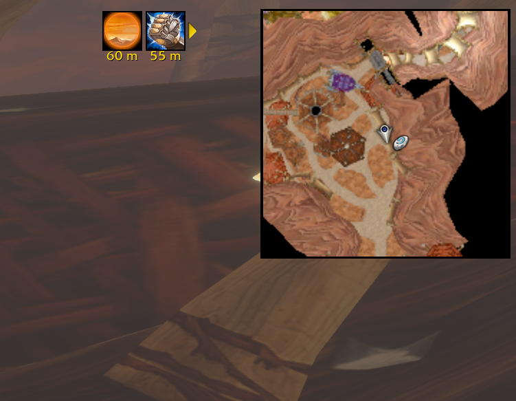
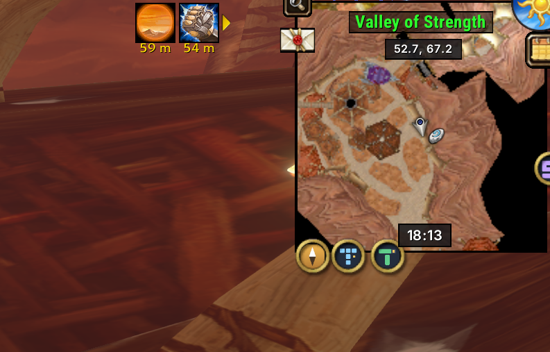
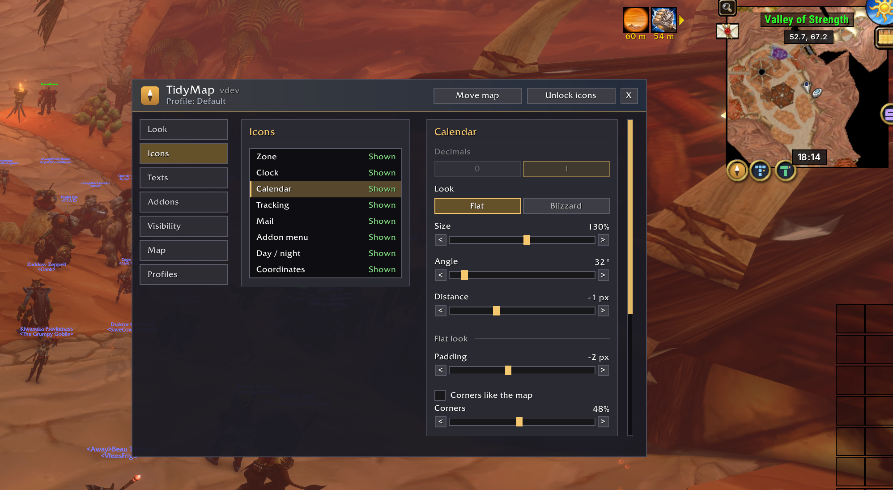

# TidyMap

A clean, shaped minimap for WoW Forever.

  
  

- Square, round or anything between, with a flat border and glow
- Blizzard's icons placed on the edge, shown, on hover or hidden
- Clean mode: icons only with the mouse over the map
- Move and resize the map anywhere
- Tidy addon buttons: flat, sized, or into the addon menu
- Profiles, English and Spanish

Open with `/tidymap` or the minimap icon.

## License

MIT
